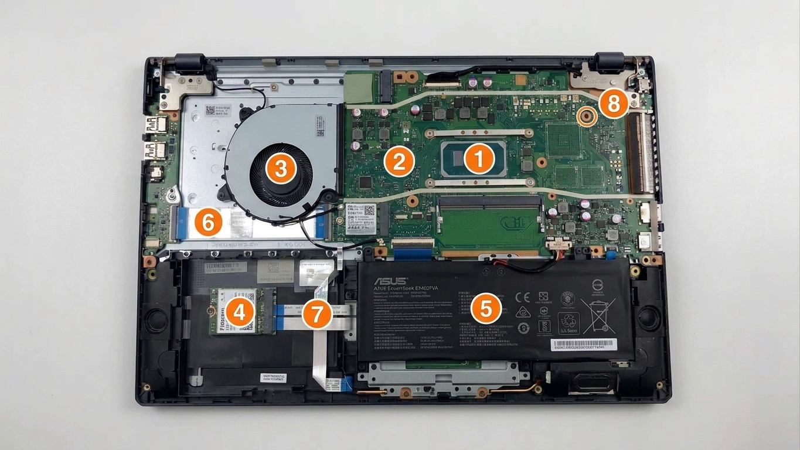

# Lab 3 - Teardown, and the same machine from the command line

Driver first half: Tolganay
Pair: none
Machine: ASUS ExpertBook B3402FVA (Host), Ubuntu 26.04 (Guest VM)
Date: 2026-11-01

##1 The machine

- **Manufacturer:** ASUSTeK COMPUTER INC.
- **Exact Model:** ASUS ExpertBook B3402FVA (System Product: ASUS ExpertBook B3402FVA)
- **Identification Command (PowerShell on Host):**
  ```powershell
  Get-CimInstance Win32_ComputerSystem
- **Hardware Manual & Documentation Sources:**
ASUS does not publish a standalone public Hardware Maintenance Manual (HMM) for consumer and business ExpertBook devices (as explicitly highlighted in the lab brief). In accordance with the course policy, official specifications and teardown documentation were combined:
i. Official ASUS ExpertBook B3402 Tech Specs
ii. ASUS ExpertBook B3402 Series User E-Manual
iii. Teardown Guide for ASUS ExpertBook B3402
## 2. Components

Below is the internal architectural layout of the **ASUS ExpertBook B3402FVA** system board:



1. **CPU / Integrated Heatsink :**
   - **What:** Intel Core processor (13th Gen Raptor Lake) integrated under the unified copper cooling heatsink.
   - **Connects to:** Soldered directly to the system board via BGA package; direct point-to-point links to memory and PCIe lanes.
   - **Limits:** Non-replaceable (soldered). Thermal performance is bounded by the cooling fan capacity.

2. **Primary Memory (SO-DIMM Slot):**
   - **What:** DDR4/DDR5 SO-DIMM expansion slot (located on the right, currently populated with a memory module). Working in conjunction with onboard soldered memory.
   - **Connects to:** CPU integrated memory controller.
   - **Limits:** Limited by module generation (DDR slot type) and maximum supported capacity according to the motherboard specification.

3. **Cooling Assembly :**
   - **What:** Single radial blower fan and copper heat pipe conducting heat from the CPU to the rear exhaust.
   - **Connects to:** Motherboard 4-pin PWM fan header.
   - **Limits:** Subject to dust buildup and RPM limits; thermal throttling may occur under heavy multi-core loads.

4. **Primary Storage (M.2 NVMe Slot / SSD):**
   - **What:** $1\times M.2~2280$ M-Key PCIe NVMe SSD slot (occupied by a solid-state drive).
   - **Connects to:** CPU/PCH high-speed PCIe lanes.
   - **Limits:** Form factor restricted strictly to length 2280 ($22~mm \times 80~mm$) with M-key interface.

5. **Main Battery Pack:**
   - **What:** Rechargeable Lithium-ion battery compartment (battery pack is removed in this photo).
   - **Connects to:** Direct multi-pin battery terminal connector on the lower edge of the motherboard.
   - **Limits:** Proprietary physical form factor; cannot be expanded beyond the battery bay dimensions.
     
6. **WLAN / Bluetooth Module :**
   - **What:** Wireless network adapter card (visible with Fidocom label near the upper-left).
   - **Connects to:** M.2 Key-E (2230) slot with antenna micro-coaxial connectors.
   - **Limits:** Form factor 2230 size restriction; upgradeable to compatible newer Wi-Fi modules.

7. **Optional Connector Area / Expansion Header:**
   - **What:** Mainboard space for optional connectors or accessory routing, configuration-dependent.
   - **Connects to:** Internal interface headers.
   - **Limits:** Bound by chassis clearance and internal cable routing paths.

8. **I/O Board Sub-assembly / Peripherals:**
   - **What:** Auxiliary input/output board and peripheral interface ports area.
   - **Connects to:** Motherboard via ribbon flex-cables.
   - **Limits:** Fixed to the laptop's physical port cutouts on the chassis side.


## What I did
- Identified the exact laptop model on the host (ASUS ExpertBook B3402FVA) and found its service manual.
- Extracted hardware specifications on Windows via PowerShell (`windows-specs.txt`) and on the Ubuntu VM (`linux-specs.png`).
- Created a 3-OS/environment comparison table showing how firmware attributes map across tools.
  

## Result

### OS Comparison Table
| Fact | Windows (Host) | Linux (VM Guest) |
| :--- | :--- | :--- |
| **CPU Model** | Get-CimInstance Win32_Processor -> Name | lscpu -> Model name |
| **Physical Cores** | NumberOfCores | Core(s) per socket |
| **Logical CPUs** | NumberOfLogicalProcessors (12) | CPU(s) |
| **Total Memory** | TotalPhysicalMemory (~16 GB) | free -h (total) |
| **Disk Interface** | Get-PhysicalDisk -> BusType | lsblk -> TRAN |
| **Motherboard** | Win32_BaseBoard -> Product (B3402FVA) | dmidecode -> 440BX Desktop Reference Platform (Virtual) |

*Note: The Linux guest correctly reflects the virtualized hardware parameters (VMware hypervisor board), while the host reveals the true physical ASUS ExpertBook hardware.*

## What did not work the first time
- Initially, copying text out of the VMware Linux guest terminal via clipboard had restrictions, so the Linux command output was successfully captured and documented via terminal screenshot evidence (`linux-specs.png`).

## Evidence
- [evidence/windows-specs.txt](evidence/windows-specs.txt) - PowerShell hardware transcript from the host.
- [evidence/linux-specs.png](evidence/linux-specs.png) - Terminal output from the Ubuntu VM guest.
- [evidence/photos/motherboard.jpg](evidence/moterboard.jpg) — Annotated internal layout diagram identifying 8 key motherboard components with connections and limitations.
